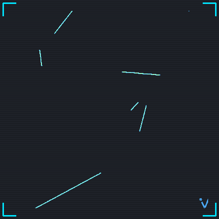
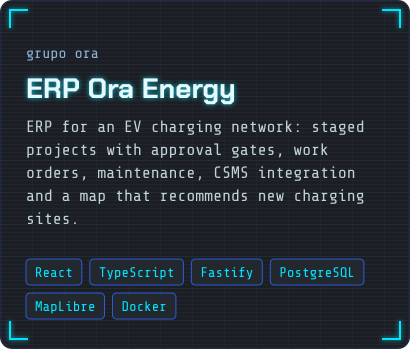
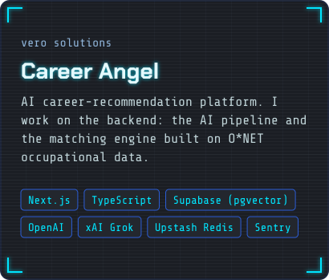
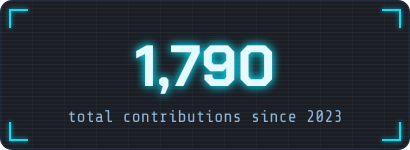

I build products end to end: backend, frontend, database, cloud infrastructure on AWS, and the generative AI that ties them together. Today I do that at **Grupo Ora** and **Vero Solutions**, shipping software that real clients use every day.

What I enjoy most is applied AI and systems designed to scale, the kind of work where a model is only useful once the architecture around it holds up.

I'm also a **Software Engineering** undergraduate. Before that, I ranked **1st overall** in the entrance exam for Computer Engineering at the **Federal University of Sergipe (UFS)**.

- 📍 Brazil
- 🗣️ Professional English: I work with international teams, technical content and documentation in English
- ☁️ 3 AWS Academy certifications, including Machine Learning for NLP
- 🤝 Open to networking and new challenges

 

Most of my work lives in private repositories. At **Grupo Ora** I build the systems that run the group's companies across energy, telecom and industry: ERP, CRMs, customer service, field operations, a console for our internal AI agent, and the security hardening of the databases behind them. Outside of that, I ship client products at **Vero Solutions**, websites, and a donation platform for a nonprofit.

  
  

- **CRM Piauí Indústrias** · Grupo Ora 
  CRM and field operations for construction jobs: sales funnel, quotes, proposals, site visits and trips, role-based access and a mobile field app. 
  React · Vite · Node.js · PostgreSQL · Docker

- **Facial Recognition API** · Piauí State Department of Justice 
  Facial recognition service integrated with the state penitentiary management system. 
  Python · FastAPI · MongoDB

- **FacialPoint** · Personal project 
  Attendance control system based on facial recognition. 
  [Site](https://github.com/Aderson79/FacialPoint-Site) · [Database](https://github.com/Aderson79/FacialPoint-Banco-Dados)

**Languages** 

**Backend** 

**Frontend & mobile** 

**Data** 

**Cloud & tooling** 

  

  
  

  
  &nbsp;
  
  &nbsp;
  

About technology, collaborations and new challenges.

[LinkedIn](https://www.linkedin.com/in/aderson-mesquita-2bb208353/) · [GitHub](https://github.com/Aderson79) · [meskytaaderson@hotmail.com](mailto:meskytaaderson@hotmail.com)

